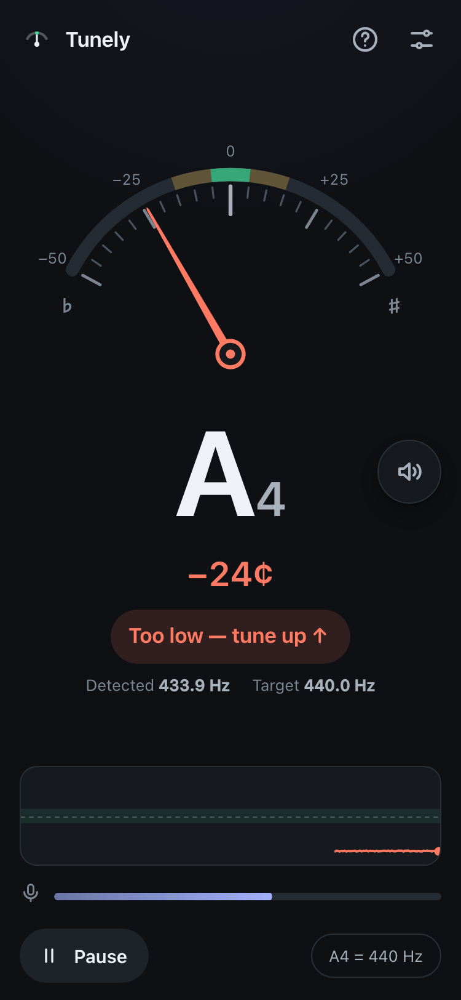
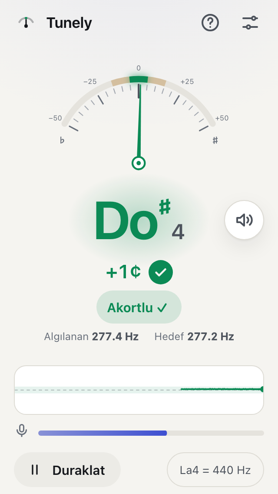

# Tunely

An accurate chromatic tuner that runs in the browser. Built with beginners tuning a **kalimba** in mind, but works for any instrument or voice. Installable as a PWA and works offline.

**Live:** <https://mustafasenses.github.io/tunely/>

<p align="center">
  
  &nbsp;
  
</p>

## Features

- ±1 cent accuracy on clean tones; handles fast-decaying kalimba notes and mains hum
- Needle gauge with colour + plain-language hints ("Too low — tune up ↑") and an in-tune lock
- Pitch history graph, reference tone, adjustable A4 (415–466 Hz)
- Note names as letters, solfège or numbers; English and Turkish; dark/light theme
- Audio is processed on-device and never leaves it

## Development

```sh
npm install
npm run dev          # http://localhost:5173/tunely/  (add ?mock for a simulated mic)
npm test             # unit tests
npm run test:e2e     # Playwright tests against the production build
npm run build        # output in dist/
```

## Deployment

Every push to `master` runs the tests and deploys to GitHub Pages via `.github/workflows/deploy.yml`.
One-time setup: repo **Settings → Pages → Source: GitHub Actions**.
